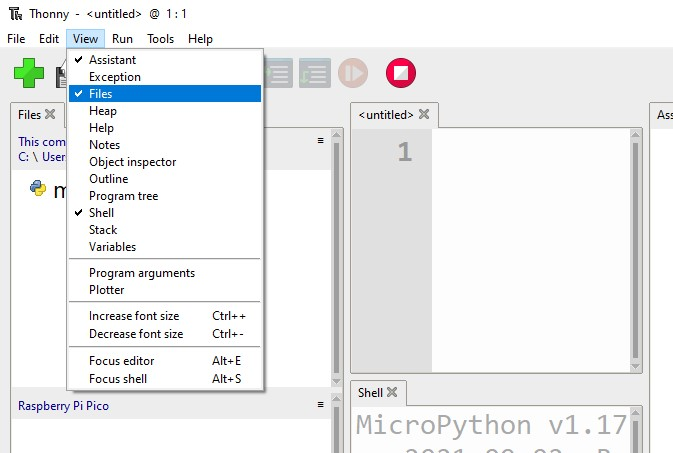
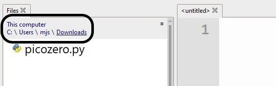
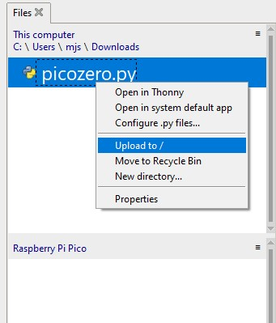
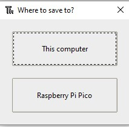
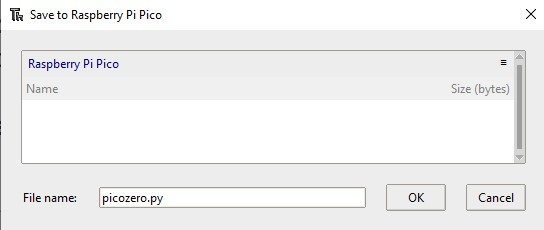

## Instalar picozero sin conexión

Si la computadora a la que conectas tu Raspberry Pi Pico no tiene acceso a internet, o no tienes permisos para instalar paquetes con Thonny, aún puedes usar la biblioteca picozero.

Puedes usar otra computadora con conexión a internet para descargar el archivo que necesitas y luego guardarlo en una memoria USB.

1. Abre el archivo `picozero.py` en el [repositorio de picozero en GitHub](https://raw.githubusercontent.com/RaspberryPiFoundation/picozero/master/picozero/picozero.py?token=GHSAT0AAAAAABRLTKWZCT53CGKBFHMJGE54YSC762A) usando un navegador web.

2. Haz clic derecho en la página de picozero, y elige **Guardar página como**.

3. Elige dónde descargar el archivo, y conserva su nombre - `picozero.py`

### Opción 1 - Transfiere archivos con el administrador de archivos de Thonny

1. Conecta tu Raspberry Pi Pico a la computadora con un cable microUSB.

2. Abre Thonny desde el menú de aplicaciones, luego selecciona la opción para ver archivos en el menú **Ver**.

    

3. Usa la ruta para ir a la carpeta donde guardaste el archivo `picozero.py`.

    

4. Haz clic derecho en `picozero.py` y selecciona **Subir a /** en el menú.

    

5. Ahora deberías ver una nueva copia de la biblioteca `picozero.py` en la Raspberry Pi Pico.

### Opción 2 - Copia y pega el archivo con Thonny

1. Selecciona todo el texto del archivo `picozero.py` presionando **Ctrl + a** en tu teclado, luego cópialo presionando **Ctrl + c**.

2. Abre Thonny, haz clic en la pestaña **sin título** y presiona **Ctrl + v** para pegar el contenido de `picozero.py` en el archivo.

3. Usa **Ctrl + s** para guardar el archivo, y cuando se te pregunte, elige guardarlo en **Raspberry Pi Pico**

    

4. Nombra el archivo `picozero.py` y luego haz clic en el botón **Aceptar**.

    

***
Este proyecto fue traducido por voluntarios:

[name]

[name]

[name]

Gracias a los voluntarios, podemos dar a las personas de todo el mundo la oportunidad de aprender en su propio idioma. Puedes ayudarnos a llegar a más personas ofreciéndote como voluntario para traducir. Más información en [rpf.io/translate](https://rpf.io/translate).
